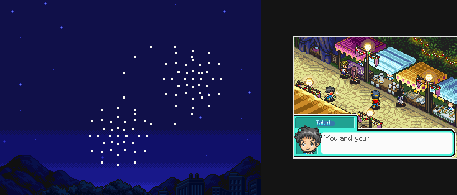
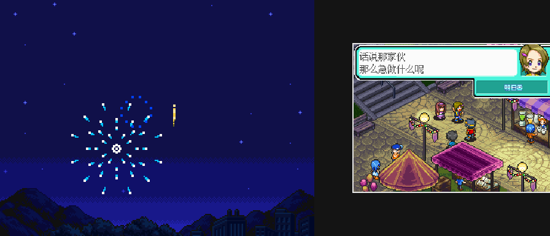
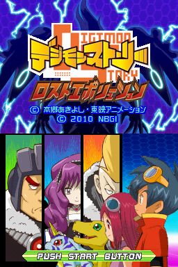
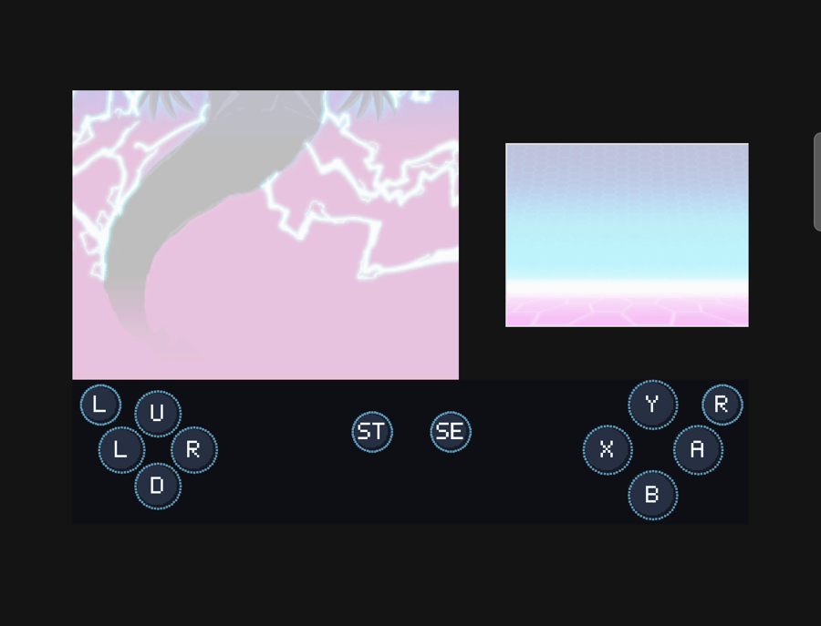
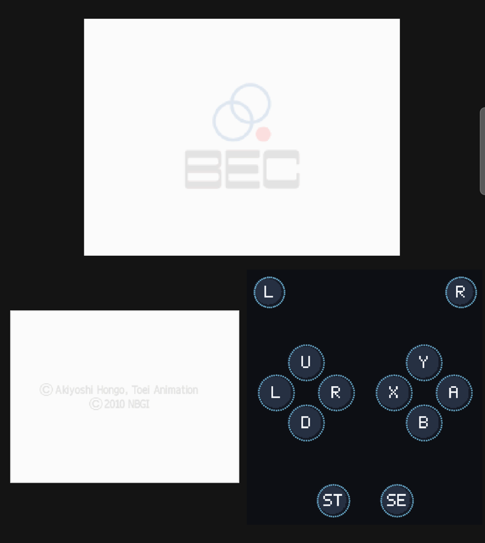

# Digimon Story: Lost Evolution Recomp

**A native PC port of *Digimon Story: Lost Evolution* (Nintendo DS, Japan) made by static recompilation. It is not an emulator. You bring your own ROM, and the game is built on your machine.**

English | [简体中文](README.zh-CN.md)

[](#build-and-play)
[](android/README.md)
[](#status)
[](#license)

| Single-screen layout (English) | Chinese patch | Japanese title |
| --- | --- | --- |
|  |  |  |

*Digimon Story: Lost Evolution* (デジモンストーリー ロストエボリューション, Bandai Namco Games, 2010) was released only in Japan. This project translates the game's ARM9 and ARM7 machine code into C ahead of time and compiles it, together with a DS hardware runtime, into a normal desktop program. One build can run three editions: the Japanese original, the Operation Decoded English fan translation and the Xzonn simplified-Chinese fan translation.

> **Unofficial fan project.** Not affiliated with or endorsed by Bandai Namco, Toei Animation, Nintendo, Operation Decoded or the Chinese localization team. No ROM, BIOS, firmware, save, patched image or recompiled game code is in this repository. Do not share the `roms/`, `generated/` or `saves/` folders, the built runner, or an APK you built: they contain or are derived from the game.

## Your ROM

| Profile | Edition | Size | SHA-1 |
| --- | --- | --- | --- |
| `ja` | Retail Japan, `BLEJ` rev 0 | 67,108,864 | `f180146f517712c177d6497125a24f35b0d6102f` |
| `en` | Operation Decoded T-En v1.1 (AP fix), trimmed | 60,598,900 | `83b4104e654ed2423c0a609802ec6b2843874fd3` |
| `zh-Hans` | Xzonn DSLEChsLocalization v1.0.1 | built from the `ja` dump | see [docs/LANGUAGES.md](docs/LANGUAGES.md) |

Put your dumps in `roms/` with the names listed in [`languages/manifest.json`](languages/manifest.json), or point `LOSTEVO_ROM_DIR` at the folder that holds them. You only need the editions you want to play. The Chinese image is made for you from the Japanese dump (`python tools/lostevo.py patch zh-Hans`).

**No BIOS or firmware dump is needed.** The runner boots on the bundled open-source [FreeBIOS](https://github.com/mstan/freebios). If you prefer your own dumps, put `biosnds9.rom` and `biosnds7.rom` in `run/bios/`; they are SHA-1 checked and used automatically.

## Build and play

You need Python 3.10+, CMake 3.20+, Ninja, a C++20 compiler (clang recommended), SDL3 and git.

### Windows

Install the toolchain from an [MSYS2](https://www.msys2.org/) shell:

```bash
pacman -S --needed mingw-w64-clang-x86_64-toolchain mingw-w64-clang-x86_64-cmake mingw-w64-clang-x86_64-ninja mingw-w64-clang-x86_64-sdl3 git
```

Then, from PowerShell in this folder, with a normal Windows Python:

```powershell
py -3 -m pip install -r requirements.txt
py -3 tools\lostevo.py build
py -3 tools\lostevo.py play
```

The build tool finds MSYS2's clang64 tools even when that shell is not active. `tools\build_lostevo.cmd` and `tools\play_lostevo.cmd` are shortcuts.

### Linux / macOS

```bash
python3 -m pip install -r requirements.txt
python3 tools/lostevo.py build
python3 tools/lostevo.py play
```

`build` fetches the pinned [ndsrecomp](https://github.com/RetroPortingToolKit/ndsrecomp) and [recomp-ui](https://github.com/RetroPortingToolKit/recomp-ui) sources into `ndsrecomp/` and `recomp-ui/`, applies the patches in [`patches/`](patches), recompiles every edition whose ROM it finds, and links one runner that contains all of them. Each edition's code is gated by its exact ROM SHA-1. The first build takes several minutes; later starts are immediate.

`play` shows a language menu and remembers the choice. `play --language en|ja|zh-Hans` skips it.

## Controls

| DS | Keyboard | Gamepad |
| --- | --- | --- |
| D-pad | Arrow keys | D-pad / left stick |
| A / B | `Z` / `X` | A / B |
| X / Y | `S` / `A` | X / Y |
| L / R | `Q` / `W` | Shoulders |
| Start / Select | `Enter` / `Backspace` | Start / Back |
| Touch screen | Mouse on the touch panel | — |

| Key | Action |
| --- | --- |
| `Shift+F1`…`F12` | Save state to slot 1–12 |
| `F1`…`F12` | Load state from slot 1–12 |

Window layout: `--layout single` (default: top screen with the touch screen as a side panel), `stacked` (the DS layout) or `separate` (two windows). Extra runner flags go after `--`, for example `python tools/lostevo.py play -- --fullscreen borderless`.

Each language has its own save (`saves/lostevo-<id>.sav`, a 64 KiB EEPROM image) and its own save-state folder, so switching language never overwrites progress.

## Status

**Early access.** Checked on Windows x86-64:

- all three editions boot from one runner: licensing screens, animated intro, title and attract sequence
- English and Japanese name entry, and a new game into the opening field dialogue in English and Chinese
- FreeBIOS boot without BIOS dumps
- save states: after save → advance → load, main RAM and the framebuffer match exactly
- the cartridge EEPROM device and save files (framework unit tests)
- the audio path: a 6,000-frame soak with no buffer underruns

Not yet verified or not implemented:

- **Gameplay beyond the opening.** Field exploration, battles, menus and later chapters have not been played through. Please [report problems](../../issues).
- **In-game save → restart → continue** has not been checked end to end.
- **Booting through the DS firmware menu** halts; the launcher uses direct boot, which is the verified path.
- The game's six ARM9 **overlays** and two relocated ARM7 blocks still run on the framework's built-in interpreter.
- **Widescreen:** the scenes checked so far are 2D, so the framework's adaptive widescreen is off.
- No prebuilt download yet: you build from source (see above).
- Wi-Fi and the microphone are not supported.

## Android (experimental)

The same runner builds as an ARM64 Android app with a first-run setup screen (pick your ROM and language), English/Japanese/Chinese profiles in one APK, on-screen controls that hide when a gamepad connects, and foldable layouts. It was tested on a Galaxy Z Fold5. The APK contains the recompiled game, so you build it yourself and must not share it. See [android/README.md](android/README.md).

| Landscape | Foldable, tabletop posture |
| --- | --- |
|  |  |

## How it works

1. `tools/prepare_lostevo.py` checks the ROM and unpacks the ARM9 and ARM7 programs and overlays.
2. The ndsrecomp recompiler turns every function it finds into C, one bank per edition.
3. clang compiles those banks with the framework's DS hardware runtime (2D engines, a melonDS-derived 3D renderer, sound, timers, DMA, cartridge) into `nds_runner`.
4. At start-up the runner hashes the inserted ROM and runs the matching bank. Translated code checks that the bytes it was built from are still in memory and falls back to the interpreter if they are not.

More: [docs/LANGUAGES.md](docs/LANGUAGES.md) (editions, patching, save isolation) and [patches/README.md](patches/README.md) (framework changes).

## Useful commands

```bash
python tools/lostevo.py status                  # ROMs, hashes, banks, configs
python tools/lostevo.py build --language en     # build one edition only
python tools/lostevo.py verify                  # boot each edition, save screenshots
python tools/lostevo.py patch zh-Hans           # make the Chinese image from the Japanese dump
python tools/savestate_smoke.py --language en   # headless save-state round trip
python tools/flow_smoke.py --language en --schedule new-game --mash-a 4800:9000:180 --checkpoint 9000
```

## License

The tooling in this repository is MIT licensed ([LICENSE](LICENSE)). The framework it builds on and the components it fetches keep their own licences, see [THIRD_PARTY_NOTICES.md](THIRD_PARTY_NOTICES.md). A runner you build includes melonDS-derived GPL-3.0-or-later code.

## Credits

- **Operation Decoded** — English fan translation v1.1 (AP fix)
- **Xzonn and the 遗失进化汉化组** — simplified-Chinese localization ([DSLEChsLocalization](https://github.com/Xzonn/DSLEChsLocalization))
- **ndsrecomp / recomp-ui** — static recompilation framework and runtime UI
- **melonDS**, **FreeBIOS**, **SDL**, **toml++** and the other components listed in the notices
