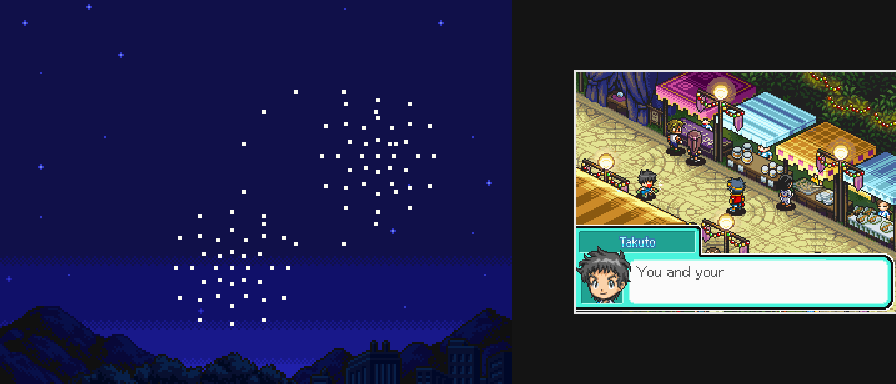
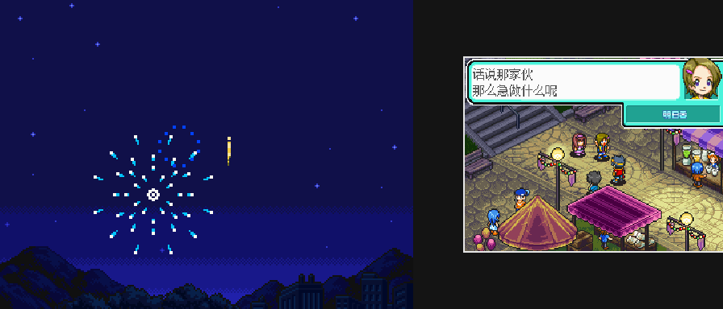
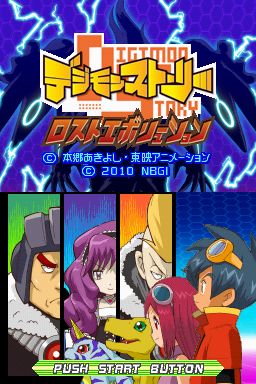

# Digimon Story: Lost Evolution Recomp（数码宝贝物语 遗失的进化 原生移植）

**通过静态重编译把 NDS 游戏《数码宝贝物语 遗失的进化》（日版）移植为 PC 原生程序。这不是模拟器。你需要自备 ROM，游戏在你自己的电脑上构建。**

[English](README.md) | 简体中文

| 单屏布局（英文版） | 中文汉化 | 日文标题 |
| --- | --- | --- |
|  |  |  |

本项目在构建时把游戏的 ARM9 / ARM7 机器码翻译成 C，再与 DS 硬件运行时一起编译成普通的桌面程序。同一个程序可运行三个版本：日文原版、Operation Decoded 英文汉化版、Xzonn 简体中文汉化版。

> **非官方粉丝项目**，与万代南梦宫、东映动画、任天堂、Operation Decoded 及汉化组均无关联。本仓库不包含任何 ROM、BIOS、固件、存档、打过补丁的镜像或重编译后的游戏代码。请勿分享 `roms/`、`generated/`、`saves/` 目录、构建出的运行程序或你自己构建的 APK——它们包含游戏内容或由游戏派生。

## ROM

| 配置 | 版本 | 大小 | SHA-1 |
| --- | --- | --- | --- |
| `ja` | 日版零售 `BLEJ` rev 0 | 67,108,864 | `f180146f517712c177d6497125a24f35b0d6102f` |
| `en` | Operation Decoded T-En v1.1（AP fix，已裁剪） | 60,598,900 | `83b4104e654ed2423c0a609802ec6b2843874fd3` |
| `zh-Hans` | Xzonn DSLEChsLocalization v1.0.1 | 由 `ja` 镜像生成 | 见 [docs/LANGUAGES.md](docs/LANGUAGES.md) |

把 ROM 按 [`languages/manifest.json`](languages/manifest.json) 中的文件名放进 `roms/`，或用环境变量 `LOSTEVO_ROM_DIR` 指向存放它们的目录。只需准备你想玩的版本。中文镜像由工具基于日版镜像生成：`python tools/lostevo.py patch zh-Hans`（自动下载汉化补丁并校验哈希）。

**不需要 BIOS 或固件 dump。** 默认使用内置的开源 [FreeBIOS](https://github.com/mstan/freebios) 启动。如果想用自己的 dump，把 `biosnds9.rom`、`biosnds7.rom` 放到 `run/bios/`，校验 SHA-1 后会自动使用。

## Windows 一键游玩

1. 从 [Releases](../../releases) 下载 `DigimonLostEvolutionRecomp-<版本>-windows-x64.zip`，把**整个**文件夹解压到可写入的位置（例如 `文档\Games`，不要放在 `Program Files`）。
2. 把你的 ROM 放进 `roms` 文件夹（文件名随意），或直接拖到 `play.bat` 上。工具按 SHA-1 自动识别版本。
3. 双击 **`play.bat`**。

首次启动会把私有构建工具包下载到 `kit\`（llvm-mingw/clang、CMake、Ninja、SDL3、xdelta3、ndspy，约 250 MiB，逐个校验 SHA-256），然后用你的 ROM 构建游戏；有日版镜像时会顺带生成中文版。大约需要 5–15 分钟，完整日志在 `run\build.log`。之后启动直接进入语言菜单。不会向系统安装任何东西，也不需要管理员权限；没有 Python 3.10+ 时会自动下载一份私有 Python。

`play.bat --rebuild` 重新完整构建；`play.bat --language zh-Hans` 跳过菜单。若 Windows SmartScreen 提示，选择“更多信息 → 仍要运行”。

## 从源码构建

需要 Python 3.10+、CMake 3.20+、Ninja、C++20 编译器（推荐 clang）、SDL3 和 git。在 Windows 的 git 仓库中直接运行 `play.bat` 也会用私有工具包完成以下全部步骤。

### Windows（MSYS2）

在 [MSYS2](https://www.msys2.org/) 终端中安装工具链：

```bash
pacman -S --needed mingw-w64-clang-x86_64-toolchain mingw-w64-clang-x86_64-cmake mingw-w64-clang-x86_64-ninja mingw-w64-clang-x86_64-sdl3 git
```

然后在本目录的 PowerShell 中（使用普通的 Windows Python）：

```powershell
py -3 -m pip install -r requirements.txt
py -3 tools\lostevo.py build
py -3 tools\lostevo.py play
```

### Linux / macOS

```bash
python3 -m pip install -r requirements.txt
python3 tools/lostevo.py build
python3 tools/lostevo.py play
```

`build` 会把固定版本的 ndsrecomp 与 recomp-ui 源码下载到 `ndsrecomp/`、`recomp-ui/`，应用 [`patches/`](patches) 中的补丁，重编译找到 ROM 的每个版本，并链接成一个运行程序。首次构建需要数分钟，之后启动是即时的。

`play` 会显示语言菜单并记住选择；`play --language en|ja|zh-Hans` 可直接指定。

## 操作

| DS | 键盘 | 手柄 |
| --- | --- | --- |
| 十字键 | 方向键 | 十字键 / 左摇杆 |
| A / B | `Z` / `X` | A / B |
| X / Y | `S` / `A` | X / Y |
| L / R | `Q` / `W` | 肩键 |
| Start / Select | `Enter` / `Backspace` | Start / Back |
| 触摸屏 | 鼠标点击触摸面板 | — |

`Shift+F1`…`F12` 保存即时存档，`F1`…`F12` 读取。布局：`--layout single`（默认，上屏 + 侧边触摸面板）、`stacked`（DS 原始上下布局）、`separate`（两个窗口）。每种语言的存档（`saves/lostevo-<id>.sav`）和即时存档目录相互独立。

## 完成度

**早期测试版。** 已在 Windows x86-64 上验证：

- 三个版本均可由同一程序启动：版权画面、开场动画、标题与演示
- 英文 / 日文命名画面；英文与中文新游戏进入开场场景对话
- 无 BIOS dump 时使用 FreeBIOS 启动
- 即时存档：保存 → 继续运行 → 读取后内存与画面完全一致
- 卡带 EEPROM 与存档文件（框架单元测试）；6000 帧音频测试无欠载

尚未验证或未实现：

- **开场之后的游戏流程**（地图探索、战斗、菜单、后续章节）尚未通关验证，欢迎[反馈问题](../../issues)
- 游戏内存档 → 重启 → 继续 的完整流程
- 通过 DS 固件菜单启动会停住；启动器使用已验证的直接启动
- 6 个 ARM9 overlay 与两段重定位的 ARM7 代码仍由内置解释器执行
- 宽屏：目前检查过的场景都是 2D，自适应宽屏默认关闭
- Linux / macOS 暂无下载包，需要从源码构建
- 不支持 Wi-Fi 与麦克风

## Android（实验性）

同一运行时可构建为 ARM64 Android 应用：首次启动选择 ROM 与语言，一个 APK 含英/日/中三个配置，虚拟按键（连接手柄后自动隐藏），支持折叠屏布局，已在 Galaxy Z Fold5 上测试。APK 内含重编译后的游戏，请自行构建且不要分享。详见 [android/README.md](android/README.md)。

## 许可

本仓库中的工具代码以 MIT 许可发布（[LICENSE](LICENSE)）。所依赖的框架与组件保持各自的许可，见 [THIRD_PARTY_NOTICES.md](THIRD_PARTY_NOTICES.md)。

## 致谢

- **Operation Decoded** — 英文汉化 v1.1（AP fix）
- **Xzonn 与遗失进化汉化组** — 简体中文汉化（[DSLEChsLocalization](https://github.com/Xzonn/DSLEChsLocalization)）
- **ndsrecomp / recomp-ui**、**melonDS**、**FreeBIOS**、**SDL**、**toml++**
